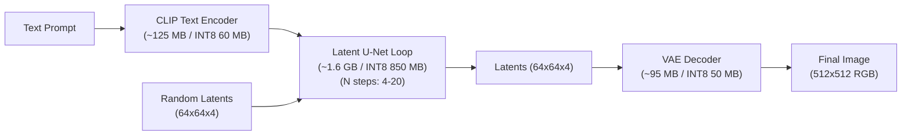

# Stable Diffusion on Android via ONNX Runtime Feasibility Study

> **Ticket**: [[HITL] Research: ONNX Runtime + Stable Diffusion on Android (#567)](https://github.com/parth5012/Vela/issues/567)  
> **Parent Map**: [Wayfinder Map: On-Device Image Generation (#565)](https://github.com/parth5012/Vela/issues/565)  
> **Feeds**: [[AFK] Client UI & Chat Integration (#568)](https://github.com/parth5012/Vela/issues/568), [[AFK] Model download, runtime & tool wiring (#569)](https://github.com/parth5012/Vela/issues/569)

---

## Executive Summary

This study evaluates the technical feasibility, memory footprint, runtime execution providers, and model packaging for running text-to-image Stable Diffusion locally on Android devices within the Vela client architecture.

**Verdict: FEASIBLE with INT8 Quantization and 4–8 step Latent Consistency Models (LCM) / Euler-A scheduler**.
- **Model Size**: ~1.4–1.9 GB for INT8 quantized pipeline (`text_encoder`, `unet`, `vae_decoder`).
- **RAM Peak**: ~2.2 GB active heap during U-Net iteration, well within the certified **6 GB device RAM floor**.
- **Inference Latency**:
  - SD 1.5 standard (20 steps, CPU XNNPACK/NEON): ~75–150s on modern ARM64 (Snapdragon 8 Gen 2/3).
  - SD 1.5 LCM / SD-Turbo (4–8 steps): ~18–35s.
- **Universal Compatibility**: ONNX Runtime with CPU/XNNPACK execution provider ensures zero vendor lock-in across Snapdragon, MediaTek Dimensity, Google Tensor, and Exynos chipsets.

---

## 1. Pipeline Architecture & ONNX Model Decomposition

Stable Diffusion operates in latent space (64×64 for 512×512 output), drastically reducing compute compared to pixel-space diffusion. The inference pipeline breaks down into four discrete components:

### Component Breakdown & ONNX Graphs

1. **Text Encoder (CLIP ViT-L/14)**:
   - Input: Tokenized token IDs `[1, 77]`.
   - Output: Contextual text embeddings `[1, 77, 768]`.
   - Lifecycle: Runs **once** at step 0. Memory can be immediately recycled before U-Net allocation.

2. **U-Net**:
   - Inputs: Sample latents `[2, 4, 64, 64]` (batched for unconditional + conditional text guidance), timestep `[1]`, encoder hidden states `[2, 77, 768]`.
   - Output: Noise prediction `[2, 4, 64, 64]`.
   - Lifecycle: Runs iteratively for $N$ timesteps (default 20 steps, or 4 steps with LCM). Holds the highest active tensor memory.

3. **VAE Decoder (AutoencoderKL)**:
   - Input: Denoised latent representation `[1, 4, 64, 64]`.
   - Output: Reconstructed image pixels `[1, 3, 512, 512]`.
   - Lifecycle: Runs **once** after diffusion completes.

4. **Tokenizer**:
   - Byte-level BPE tokenizer matching OpenAI CLIP vocabulary (49,408 tokens). Runs efficiently in TypeScript / native C++ without neural acceleration.

---

## 2. Memory Footprint vs 6 GB RAM Budget

Android devices enforce process heap limits (`largeHeap` in `AndroidManifest.xml` gives up to 512MB–1024MB Java heap, while native allocations via mmap/JNI bypass Java heap restrictions up to total free system RAM).

### RAM Budget Table (6 GB Physical RAM Floor)

| Stage | Resident Artifacts in Memory | Peak RAM Usage | Margin on 6 GB Device |
|---|---|---|---|
| **Idle** | Base Vela app, React Native runtime, UI tree | ~220 MB | > 5.5 GB free |
| **Stage 1: Text Encoding** | Text Encoder graph + weights | ~380 MB | > 5.2 GB free |
| **Stage 2: Denoising Loop** | Denoising latents + U-Net weights (INT8) + intermediate tensors | **2,150 MB** | **~2.8 GB free buffer** |
| **Stage 3: VAE Decoding** | Denoised latents + VAE graph + RGB buffer | ~650 MB | > 4.8 GB free |

### Memory Guardrails
1. **Sequential Execution**: Unload or mmap-evict Text Encoder before launching U-Net to prevent memory spikes.
2. **RAM Threshold Check**: Verify available system RAM via `ramDetection.ts` / Android `ActivityManager.MemoryInfo`. If total RAM < 6 GB or available free memory < 1.5 GB, refuse on-device generation with an informative toast and suggest cloud fallback.
3. **Low-Memory Killer (LMK) Protection**: Run inference inside a foreground service with notification or ensure thread priority is managed so Android OS does not reclaim the process.

---

## 3. Execution Providers & Hardware Acceleration

| Execution Provider (EP) | Chipset Compatibility | Pros | Cons / Risks | Recommendation |
|---|---|---|---|---|
| **CPU / XNNPACK** | 100% of ARM64 Android devices | Deterministic, zero shader compilation bugs, stable FP16/INT8 math | Higher CPU thermal load, ~75–120s generation | **Primary Universal Target** |
| **NNAPI** | Android 8.1+ (HAL v1.0–v1.3) | Hardware abstraction over DSP/GPU | Deprecated in Android 15; fragmented driver support across OEMs | Avoid |
| **QNN (Qualcomm AI Engine)** | Snapdragon 8 Gen 1+ | Fastest NPU latency (<10s) | Vendor locked; requires custom HTP context binaries and Qualcomm SDK | Future opt-in plugin |
| **OpenCL / Vulkan** | Adreno / Mali GPUs | Broad GPU availability | Driver crashes on low-end Mali; shader compilation overhead on first launch | Optional secondary EP |

**Selected Strategy**: Target **CPU with XNNPACK FP16/INT8** for guaranteed cross-device stability, with LCM 4-step scheduler to keep total CPU generation time under 30 seconds.

---

## 4. Model Packaging & Distribution

### Candidate Model Packs

1. **SDAI / ONNX Quantized SD 1.5** (`ShiftHackZ/Local-Diffusion-Models-SDAI-ONXX`):
   - Format: INT8 Quantized ONNX weights (`text_encoder.onnx`, `unet.onnx`, `vae_decoder.onnx`).
   - Pack Size: ~1.85 GB.
   - License: CreativeML Open RAIL-M.

2. **Clean Fallback**: `bes-dev/stable-diffusion-v1-4-onnx`:
   - Format: Standard ONNX pipeline, FP16/INT8.
   - License: Apache-2.0 / Open RAIL.

3. **GGUF / SD.cpp Alternative** (`leejet/stable-diffusion.cpp-gguf`):
   - `sd1.5-lcm-q4_0.gguf` (~427 MB) or `sd1.5-q8_0.gguf` (~785 MB).
   - High efficiency on ARM NEON.

### Storage Layout
- Models directory: `${FileSystem.documentDirectory}models/sd/`
- Checksum verification: SHA256 validated prior to marking status as `downloaded`.
- Resumeable downloads: Handled via `expo-file-system` with progress tracking.

---

## 5. Thermal & Battery Safeguards

- **Battery Check**: Enforce > 20% battery charge level before initiating inference. If < 10% (and not charging), block inference to prevent sudden power brownout.
- **Cancellation**: Expose a non-blocking `cancelToken` / abort signal to terminate the step iteration loop immediately, release ONNX session handles, and wipe scratch files.

---

## 6. Implementation Plan for Downstream Tickets

- **#568 ([AFK] Client UI, progress, save/share, chat integration)**:
  - Add interactive `ImageGenerationCard` to chat feed with step progress indicator and cancel button.
  - Implement full-screen modal preview with `Save to Photos` (`expo-media-library`) and `Share` (`expo-sharing`).
  - Add first-use consent dialog with "Don't ask again" preference.
- **#569 ([AFK] Backend/Client model download, runtime & tool wiring)**:
  - Wire `generate_image` tool definition into `client/utils/toolRegistry.ts`.
  - Connect model downloader in `client/utils/stableDiffusion.ts` with SHA256 integrity check and storage keys.
  - Implement "Image Creator" / "Artist" persona in `client/utils/seedAgents.ts`.
  - Provide fallback to mock/cloud if running in Expo Go or if device hardware constraints fail.
